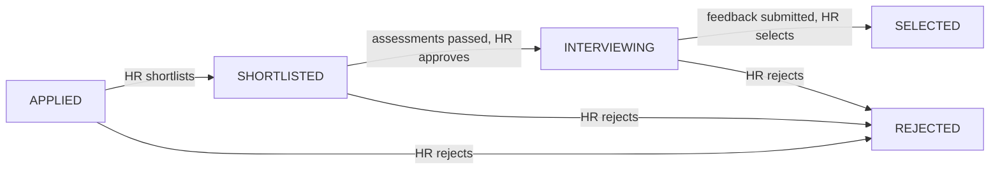

# Hiring & Assessment Platform

A full-stack recruitment platform where **HR** posts jobs, **candidates** apply with a resume and take timed assessments, and **interviewers** run the final interview. Resumes are parsed and scored with AI, assessments are proctored and auto-submitted, and every role sees updates in real time.

> Capstone project for the Tridhya Full Stack internship.

---

## Table of contents

- [Features](#features)
- [Tech stack](#tech-stack)
- [How the hiring flow works](#how-the-hiring-flow-works)
- [Project structure](#project-structure)
- [Getting started](#getting-started)
- [Environment variables](#environment-variables)
- [Demo data](#demo-data)
- [Running with Docker](#running-with-docker)
- [API overview](#api-overview)
- [Real-time events](#real-time-events)
- [Assessments and proctoring](#assessments-and-proctoring)
- [Authentication](#authentication)
- [Deployment notes](#deployment-notes)
- [Known limitations and roadmap](#known-limitations-and-roadmap)

---

## Features

**Candidate**
- Register, log in, and manage a profile
- Browse open jobs and apply with a PDF or DOCX resume (max 5 MB)
- AI-generated resume summary, skills, strengths, missing skills and a job-match score
- Take assessment rounds in order: MCQ, coding, written
- Track application status, view results, see scheduled interviews
- In-app and email notifications

**HR**
- Create, edit and close jobs; configure interview rounds and questions
- View all candidates and applications, view and download resumes
- Shortlist, approve for interview, select or reject (enforced status transitions)
- Review assessment results and AI-assisted evaluation of written answers
- Assign interviewers and schedule final interviews
- Dashboard analytics (jobs, applications, scores, interviews)
- Manage user roles and activate or deactivate accounts

**Interviewer**
- See only the interviews assigned to them
- View the assigned candidate's resume
- Submit structured feedback (ratings, strengths, weaknesses, recommendation)

**Platform**
- Real-time updates over Socket.IO
- Server-owned assessment timer with automatic submission
- Tab-switch and camera violation tracking
- Resume storage in Supabase Storage
- Email notifications through Gmail (Nodemailer)

---

## Tech stack

| Layer | Technology |
|---|---|
| Frontend | React 19, TypeScript, Vite, Tailwind CSS 4, React Router, Axios, Socket.IO client, Lucide icons |
| Backend | Node.js, Express 5, TypeScript, TypeORM, Zod, Socket.IO, node-cron |
| Database | PostgreSQL (Supabase) |
| File storage | Supabase Storage (private `resumes` bucket) |
| AI | Google Gemini (`@google/genai`) for resume analysis, written-answer evaluation and candidate summaries |
| Auth | JWT access token + httpOnly refresh-token cookie, bcrypt password hashing |
| Email | Nodemailer (Gmail) |
| Resume parsing | `pdf-parse` (PDF), `mammoth` (DOCX) |
| Deployment | Docker, Vercel |

---

## How the hiring flow works



1. A candidate applies. The resume is parsed, analysed by AI, and stored.
2. HR shortlists the candidate, which unlocks the assessment rounds.
3. The candidate completes the rounds in order (MCQ, coding, written). Failing a round rejects the application.
4. After all assessments are passed, HR approves a final interview and assigns an interviewer.
5. The interviewer submits feedback. HR can only mark the candidate **SELECTED** once feedback exists.

Invalid status jumps are rejected by the API, and updates are conditional so two simultaneous changes cannot overwrite each other.

---

## Project structure

```
Capstone/
├── backend/
│   ├── src/
│   │   ├── controller/      # Request handlers (auth, jobs, applications, assessments, ...)
│   │   ├── routes/          # Express routers, one per module
│   │   ├── lib/
│   │   │   ├── config/      # db, socket, storage
│   │   │   ├── entity/      # TypeORM entities
│   │   │   ├── middleware/  # auth, role guard, upload, error handler
│   │   │   ├── services/    # JWT, AI, notifications
│   │   │   ├── utils/       # resume parser, timers, proctoring, evaluation, cron job
│   │   │   └── validation/  # Zod schemas
│   │   ├── app.ts           # Express app
│   │   ├── server.ts        # Entry point (DB, sockets, cron)
│   │   └── seed.ts          # Demo data
│   ├── Dockerfile
│   ├── Dockerfile.vercel
│   └── docker-compose.yml
└── frontend/
    └── src/
        ├── component/       # Shared and role-specific components
        ├── context/         # Auth and real-time providers
        ├── pages/           # auth/, candidate/, hr/, interviewer/ plus role-switching wrappers
        └── services/        # Axios client and API helpers
```

Pages such as `pages/Dashboard.tsx` and `pages/Job.tsx` pick the correct HR or candidate view from the logged-in user's role.

---

## Getting started

### Prerequisites

- Node.js 20 or newer (developed on Node 24)
- A PostgreSQL database. A free [Supabase](https://supabase.com) project works.
- A Supabase Storage bucket named `resumes` (private)
- A Google Gemini API key
- Optional: a Gmail account with an app password for email notifications

### 1. Clone

```bash
git clone https://github.com/Kanvi-doshi/Tridhya-FullStackIntern.git
cd Tridhya-FullStackIntern/Capstone
```

### 2. Supabase setup

1. Create a project and copy the database connection details.
2. Go to **Storage**, create a **private** bucket named `resumes`.
   - Set the file size limit to `5 MB`.
   - Allowed MIME types: `application/pdf, application/vnd.openxmlformats-officedocument.wordprocessingml.document`
3. Copy the project URL and the service role key from **Project Settings → API**. The key stays on the backend only.

### 3. Backend

```bash
cd backend
npm install
cp .env.example .env     # then fill in the values (see below)
npm run dev
```

The API starts on `http://localhost:5000`. On first start, TypeORM creates the tables automatically (`synchronize: true`).

### 4. Frontend

```bash
cd frontend
npm install
```

Create `frontend/.env`:

```
VITE_API_URL=http://localhost:5000
```

```bash
npm run dev
```

The app opens on `http://localhost:5173`.

### Scripts

| Where | Command | What it does |
|---|---|---|
| backend | `npm run dev` | Start with hot reload (tsx) |
| backend | `npm run build` | Compile TypeScript to `dist/` |
| backend | `npm start` | Run the compiled server |
| backend | `npm run seed` | Insert demo data (see [Demo data](#demo-data)) |
| frontend | `npm run dev` | Start the Vite dev server |
| frontend | `npm run build` | Type-check and build for production |
| frontend | `npm run lint` | Run ESLint |
| frontend | `npm run preview` | Preview the production build |

### Frontend (`frontend/.env`)

| Variable | Description |
|---|---|
| `VITE_API_URL` | Backend base URL, for example `http://localhost:5000` |

Never commit `.env` files, and never put the Supabase service role key in the frontend.

---

## Demo data

The seed script creates a demo job, four rounds (MCQ, coding, written, interview), and users in different stages of the pipeline.

```bash
# macOS / Linux
SEED_DEMO_DATA=true npm run seed

# Windows PowerShell
$env:SEED_DEMO_DATA="true"; npm run seed
```

Demo password for every seeded account: `123456`

| Role | Email |
|---|---|
| HR | `hr@gmail.com` |
| Interviewer | `interviewer@gmail.com` |
| Candidate (applied) | `user_1@gmail.com` |
| Candidate (shortlisted) | `user_2@gmail.com` |
| Candidate (assessment in progress) | `user_3@gmail.com` |
| Candidate (failed) | `user_4@gmail.com` |
| Candidate (written answer pending evaluation) | `user_5@gmail.com` |
| Candidate (interview scheduled) | `user_6@gmail.com` |
| Candidate (selected) | `user_7@gmail.com` |

## Running with Docker

```bash
cd backend
docker compose up --build
```

This builds the backend image, reads `backend/.env`, and serves the API on port `5000`. Run the frontend separately with `npm run dev`.

---

## API overview

All endpoints live under `/api` and expect `Authorization: Bearer <access token>` unless noted.

| Base path | Purpose | Access |
|---|---|---|
| `/api/auth` | Register, login, refresh, logout, current user, update profile | Public / authenticated |
| `/api/job` | List, view, create, update, delete jobs | Read: authenticated. Write: HR |
| `/api/application` | Apply, list own applications, view, cancel, download resume | Candidate, HR, assigned interviewer |
| `/api/interview-round` | Manage rounds per job | HR |
| `/api/question` | Manage questions per round | HR |
| `/api/assessment` | Start, answer, submit, result, violation reporting | Candidate |
| `/api/evaluation` | Calculate and read overall candidate evaluation | HR |
| `/api/written-evaluation` | AI-assisted evaluation of written answers | HR |
| `/api/candidate-ai` | AI candidate summary and recommendation | HR |
| `/api/interview-assignment` | Assign and schedule interviews | HR, candidate (read own) |
| `/api/interview-feedback` | Submit and read interview feedback | Interviewer, HR |
| `/api/interviewer` | Interviewer's assigned interviews | Interviewer |
| `/api/hr` | Candidates, interviewers, role and status management, analytics | HR |
| `/api/reports` | Report generation | HR |
| `/api/notifications` | List, mark read, delete notifications | Authenticated |

Errors use a consistent JSON shape from a central error handler. Request bodies are validated with Zod.

---

## Real-time events

Socket.IO connects after login using the access token. Users join rooms by role (`hr`, `interviewers`) and a personal room (`candidate:<id>`).

| Event | Meaning |
|---|---|
| `hr:updated` | HR data changed (new application, status change) |
| `interviews:updated` | Interview schedule or assignments changed |
| `candidate:updated` | Candidate-specific data changed |
| `application:statusChanged` | An application's status changed |
| `notification:new` / `notification:updated` | Notification created or read |
| `assessment:started` / `submitted` / `evaluated` / `violation` | Assessment lifecycle |

The frontend groups events that arrive close together and refreshes data once.

---

## Assessments and proctoring

- **Rounds run in order** and unlock only after the previous one is passed.
- **The server owns the timer.** The deadline is calculated from the start time and the round's duration. The client counts down using the server's clock offset, not the candidate's system clock.
- **Auto-submit:** a cron job runs every minute and submits expired attempts, and expiry is also checked when an attempt is opened.
- **Violations:** tab switches and a disabled camera are reported to the server and recorded on the attempt. They can trigger an automatic submission.
- **Answers are never exposed:** correct options and test cases stay on the server.
- **Evaluation:** MCQ answers are graded directly, coding answers run against hidden test cases, and written answers are scored with Gemini.

---

## Authentication

- Passwords are hashed with bcrypt.
- The **access token** (15 minutes) is sent in the `Authorization` header.
- The **refresh token** (7 days) lives in an `httpOnly` cookie. In production it uses `SameSite=None; Secure` so it works when the frontend and backend are on different domains.
- The Axios client refreshes an expired access token once, queues concurrent requests while refreshing, and sends the user to login if refresh fails.
- Role checks use the logged-in user's role, and ownership checks keep users within their own data (for example, an interviewer can only open resumes for candidates assigned to them).

---

## Deployment notes

- Set `NODE_ENV=production` on the backend.
- Set `CORS_ORIGINS` to the exact frontend origin (scheme and host, no trailing slash).
- Use the Supabase **transaction pooler** (port `6543`) and keep the TypeORM pool small (`max: 5` in `db.ts`) to stay within connection limits.
- Run the assessment-expiry cron on **one** deployment only: set `RUN_CRON=true` there and leave it unset everywhere else, including your laptop.
- Keep the backend and database in the same region, ideally close to your users.
- Frontend on Vercel needs a rewrite so client-side routes work on refresh:

  ```json
  { "rewrites": [{ "source": "/(.*)", "destination": "/index.html" }] }
  ```

- If the frontend and backend are on different `*.vercel.app` domains, some browsers block the cross-site refresh cookie. A custom domain shared by both, or proxying `/api` through the frontend, avoids this.
- Realtime requires a backend that can hold WebSocket connections. If you run more than one instance, add a Socket.IO adapter (for example Redis) so events reach every connected client.

---

## Known limitations and roadmap

- **Coding evaluation runs candidate code with `node:vm` inside the API process.** This is not a security boundary. It should move to an isolated sandbox (separate container or a service like Judge0) before real use.
- `synchronize: true` creates and alters tables automatically. Use migrations for production.
- Add rate limiting and security headers (`helmet`).
- Add pagination to the job and application lists.
- Add unique constraints for one application per candidate per job and per attempt round.
- AI inputs (resumes, written answers) are placed in prompts directly. Treat AI scores as advisory, and harden the prompts against injection.
- No automated tests yet.
- Email lowercasing on registration, and a custom domain setup for cross-site cookies.